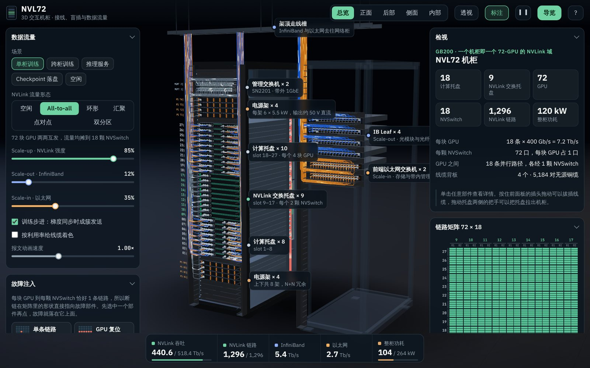

# NVL72 · 3D 交互机柜

一个可以在浏览器里直接操作的 NVIDIA GB200 NVL72 机柜模型：按真实接线规则连好的 1,296 条 NVLink、可以用鼠标拔插的前面板线缆、可以拉出推回的托盘，以及四张网络上的数据流量仿真。

在线地址：<https://dcyber-lab.github.io/nvl72-3d/>



## 能做什么

**物理连线与插拔**

- 前面板 233 根线缆逐根建模：72 根 InfiniBand（OSFP）、72 根以太网（QSFP112）、89 根带外管理（RJ45），从端口经理线槽、架顶走线槽一直连到对端交换机。
- 按住插头拖动即可拔出。线缆是绳索物理模型，会下垂、摆动，长度有限；拖到同型空端口附近会吸附，松手插入。OSFP、QSFP112、RJ45 互不通用。
- 插到别的端口上链路能起来，但会被判为“接线与规划不符”。
- 拖动托盘两侧的把手（或双击托盘）把托盘拉出机柜：后部的 NVLink 连接器、汇流排取电夹、液冷快接头一起盲插脱开，推回后链路重新训练。没先拔线就硬拉，线缆会被拉脱。
- 后部 4 个 NVLink 线缆背板可以整体拔出。

**数据流量**

- NVLink 按真实拓扑路由：每块 GPU 到每颗 NVSwitch 恰好 1 条链路，任意两块 GPU 之间有 18 条并行路径，每条链路每方向 400 Gb/s。
- 流量形态可选 all-to-all、环形、汇聚、点对点、双分区；链路上移动的报文密度就是该方向的利用率。
- 断链后流量自动改走剩余路径，带宽按比例下降；汇聚时目标 GPU 的下行口拥塞，`XmitWait` 增长。
- InfiniBand（Scale-out）、以太网（Scale-in）、带外遥测、汇流排供电、液冷回路同屏可见，可按图层开关。

**故障与排查**

- 一键注入：单条链路、GPU 复位、计算托盘离线、单颗 NVSwitch、交换托盘、线缆背板、链路误码、采集中断。
- 72 × 18 链路矩阵实时显示断链的形状，并读出它指向的部件；告警规则给出影响面。
- 检视面板里的计数器沿用 NMX-T 的名称（`PortXmitDataExtended`、`LinkDownedCounterExtended` 等）。

**其它**

- 透视模式看 72 块 GPU、18 颗 NVSwitch 和托盘内走线；8 步导览；手机上可用。

## 操作

| 操作 | 方式 |
| --- | --- |
| 旋转 / 缩放 / 平移 | 左键拖动 · 滚轮或双指 · 右键拖动 |
| 查看部件 | 悬停看摘要，单击选中 |
| 拔插线缆 | 按住插头拖动 |
| 拉出 / 推回托盘 | 拖动把手，或双击托盘 |
| 快捷键 | `1`–`5` 视角 · `X` 透视 · `L` 标注 · `空格` 暂停 · `F` 聚焦 · `Esc` 取消选中 |

地址栏参数可以直接打开某个状态，例如 `?view=rear&xray=1&sel=gpu:61`、`?fault=tray`、`?tour=1`。

## 本地运行

没有构建步骤，任何静态服务器都可以：

```bash
python3 -m http.server 8765
```

然后打开 <http://127.0.0.1:8765/>。

模型自检（接线规则、流量、故障形状与功率封顶的数值）：

```bash
node tools/simtest.mjs
```

线缆状态机与绳索求解器的回归检查（拔插、错接、够不着、托盘拉脱、自动接线）：

```bash
node --experimental-loader ./tools/three-loader.mjs tools/cabletest.mjs
```

`tools/` 下的 `e2e-*.js` 是用 Playwright 驱动真实鼠标操作的冒烟脚本（拔插线缆、拉出托盘、导览、绳索稳定性），需要本地静态服务器跑在 8765 端口：

```bash
node tools/e2e-plug.js /tmp
```

## 模型依据

取自 NVIDIA 与整机厂商公开资料的部分：机柜尺寸与 48U 布局、托盘数量与组成、每条 NVLink 的速率、后部“歧管 – 2 背板 – 汇流排 – 2 背板 – 歧管”的排列、电源架规格、液冷范围。

接线规则：GPU 端口 `p` 去往 `slot = 9 + ⌊(p − 1) / 2⌋`，奇数口到 `swt-01`，偶数口到 `swt-02`；NVSwitch 端口号 `= 4 × tray_index + NN`。

建模假设：每个线缆背板对应各托盘同一编号的 GPU；前面板端口的具体排列、理线走向、管理交换机端口分配、右侧的网络柜；功耗、温度、流量强度为按公开量级给出的仿真值。页面内“？”里有完整说明和资料链接。

本项目是独立制作的教学示意，与 NVIDIA 无隶属关系。

## 代码结构

```
index.html        页面骨架
css/style.css     界面样式
src/topology.js   逻辑模型：托盘、GPU、NVSwitch、链路、端口、接线表
src/sim.js        流量、功耗、遥测与告警规则
src/ribbon.js     线缆 / 链路的渲染（impostor 管 + 报文脉冲着色器）
src/cables.js     前面板线缆：走线、插头、绳索物理、插拔
src/links.js      NVLink 线束、液冷回路、供电路径
src/units.js      托盘、电源架、管理交换机的 3D 构件
src/rack.js       机柜框架、线缆背板、汇流排、歧管
src/interact.js   拾取、悬停、拖拽
src/ui.js         面板、检视器、链路矩阵、告警
src/tour.js       导览
src/main.js       装配与主循环
```

## 第三方

- [three.js](https://threejs.org/) r170，MIT（`vendor/THREE-LICENSE`）
- IBM Plex Sans、JetBrains Mono，SIL Open Font License 1.1（`assets/fonts/`）
